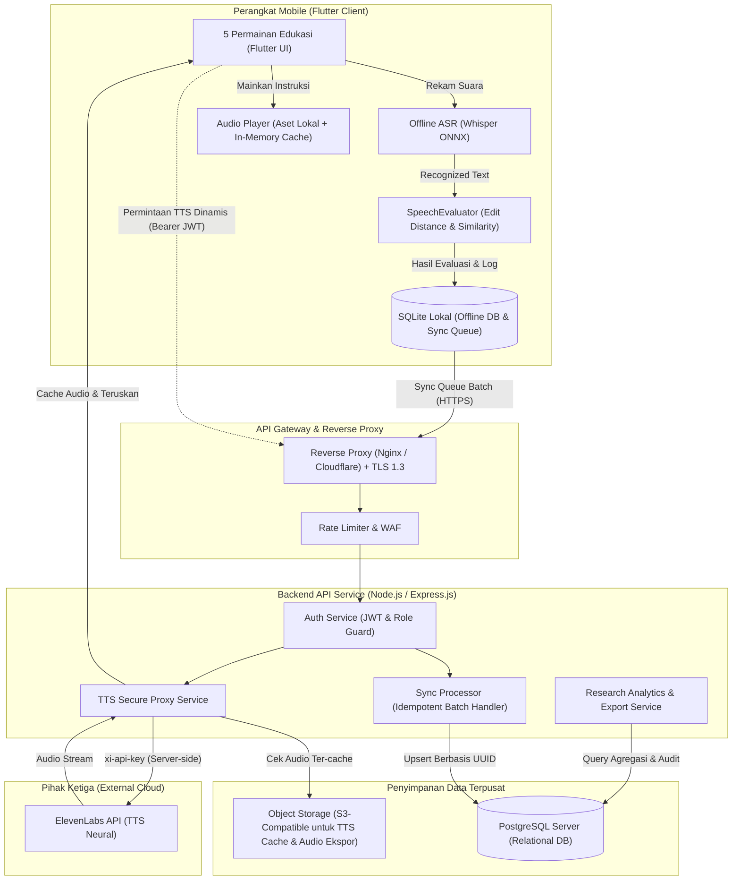
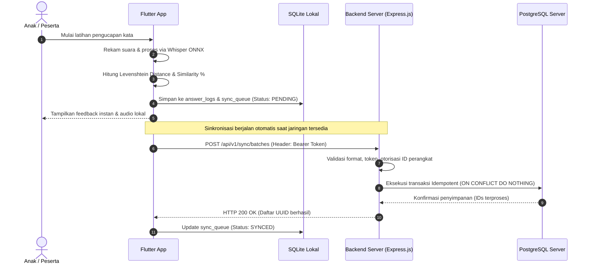
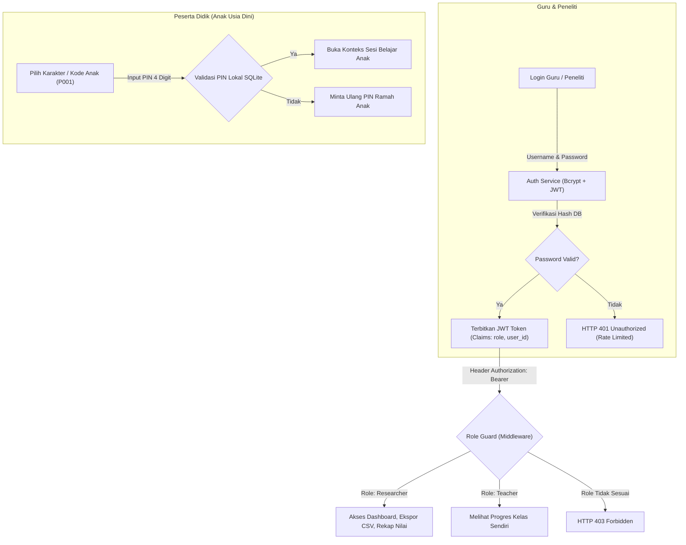
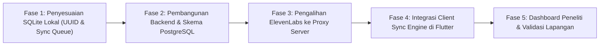

# Arsitektur Backend dan Infrastruktur Produksi — Kogo Voice Learning

> **Status (2.0):** This is the original design proposal and is kept for the thesis history. Several details below
> describe a *target* that was implemented differently. The authoritative, implemented behaviour is in
> [API_DOCUMENTATION.md](./API_DOCUMENTATION.md) and [DEPLOYMENT_COOLIFY.md](./DEPLOYMENT_COOLIFY.md). Notable differences:
> - Routes are `/api/v2/devices/register`, `/api/v2/sync`, `/api/v2/research/metrics`, `/api/v2/research/export/*.csv`
>   and `/api/voice/tts|stt` (not `/api/v1/sync/batches`, `/api/v1/tts/synthesize`); there is no refresh endpoint yet.
> - The thesis ERD is implemented by `backend/migrations/004_thesis_erd.sql` (`materi`, `word_types`, `words`,
>   `reward_tiers`, `app_devices`, `learners`, `game_sessions`, `answer_attempts`, `stars`, `rewards`).
> - UUIDs use PostgreSQL's built-in `gen_random_uuid()`; the `uuid-ossp` extension is no longer required.
> - Devices authenticate with a device token (JWT HS256, `tokenType: device`, `sub` = internal device id); re-registration
>   needs the one-time `deviceSecret`; new devices are pending until a researcher approves them
>   (`migrations/005_device_trust_and_voice_budget.sql`). Staff accounts come from the admin bootstrap; there is no public registration.
> - Deployment is Docker/Coolify (not PM2/NGINX); the TTS cache is a disk volume (no S3).

Dokumen ini memuat analisis sistem terkini, evaluasi arsitektur, spesifikasi teknis backend, desain basis data, kontrak antarmuka API, protokol sinkronisasi offline-to-online, keamanan data anak, serta rencana migrasi untuk platform edukasi anak usia dini **Kogo Voice Learning**.

---

## 1. Temuan Kode Sumber Saat Ini (Current State) vs Usulan Desain (Target State)

Pemeriksaan kode sumber aktual (`pubspec.yaml`, `lib/data/`, `lib/services/`, `lib/features/`, dan `assets/`) menghasilkan temuan berikut:

### 1.1 Temuan Faktual pada Kode Sumber
1. **Penyimpanan Lokal**: SQLite diimplementasikan via paket `sqflite` (database versi 5, file `kogo_voice_learning.db`). Tabel yang sudah ada: `users`, `children`, `devices`, `stages`, `lessons`, `questions`, `research_sessions`, `answer_logs`, `speech_logs`, `achievements`, dan `child_achievements`.
2. **Karakteristik ID Saat Ini**: Semua tabel SQLite masih mengandalkan `INTEGER PRIMARY KEY AUTOINCREMENT` lokal. Hal ini berisiko collision/duplikasi jika beberapa perangkat mengirim ID integer yang sama ke server terpusat.
3. **Pengenalan Suara**: Berjalan secara lokal (offline) menggunakan model ONNX Whisper (`decoder`, `encoder.int8.onnx` ~126 MB, `joiner`, `tokens.txt`) di folder `assets/models/indonesian_phoneme/`, dipadukan dengan `speech_to_text` dan restricted vocabulary.
4. **Evaluasi Pengucapan**: Dikelola oleh `SpeechEvaluator` (`lib/services/speech/speech_evaluator.dart`) dengan menghitung normalized Levenshtein Edit Distance, menghasilkan `similarityScore` (0.0–1.0), `similarityPercent` (0.0–100.0%), status `isCorrect`, dan `confidence` ASR.
5. **Autentikasi & Sesi**:
   - `HashService` menggunakan `sha256` dengan *hardcoded salt* `'kogo_research_salt'`.
   - `SessionManager` mengelola sesi pengguna: anak login menggunakan `child_code` (misal `P001`) dan 4 digit PIN, sedangkan peneliti login dengan `username` dan `password_hash`.
   - Akun *default seed*: `researcher` (password hash `kogo2026`) dan 40 peserta anak (`P001`–`P040`).
6. **Aset Audio & ElevenLabs**:
   - Aset lokal tersimpan di `assets/audio/` (subfolder `instructions`, `invitations`, `correct`, `almost_correct`, `incorrect`, `no_recognition`, `streak`, `completion`, `words`, `games`).
   - `ElevenLabsTtsService` memanggil langsung endpoint `https://api.elevenlabs.io/v1` via header `xi-api-key` yang dibaca dari environment compiler (`--dart-define ELEVENLABS_API_KEY=...`).
   - Kunci API berisiko terekstrak dari string binary APK produksi bila dipasang langsung di sisi klien.

---

## 2. Arsitektur Sistem dan Diagram Alur

Sistem dirancang dengan pendekatan **Offline-First Resilience**: perangkat bergerak menjalankan seluruh siklus belajar-mengajar tanpa koneksi internet, sementara backend berperan sebagai orkestrator identitas, penyimpanan data penelitian terpusat, pengelola sinkronisasi, dan proksi aman ke penyedia layanan pihak ketiga (ElevenLabs).



### 2.1 Alur Siklus Hidup Data (Data Lifecycle Flow)


---

## 3. Pembagian Tanggung Jawab Komponen Sistem

| Komponen | Lingkungan | Tanggung Jawab Utama | Batasan |
| :--- | :--- | :--- | :--- |
| **Flutter App** | Klien (Android / iOS) | 1. Menjalankan 5 modul permainan anak.<br>2. Menjalankan speech recognition (Whisper ONNX) offline.<br>3. Menghitung jarak Levenshtein dan nilai kemiripan.<br>4. Memutar efek audio lokal dan audio instruksi.<br>5. Menyimpan log ke SQLite seketika (zero latency). | Tidak boleh menyimpan API Key pihak ketiga. Tidak boleh bergantung pada internet untuk alur belajar utama. |
| **SQLite** | Klien (Penyimpanan Lokal) | 1. Menyimpan data master kurikulum lokal (`stages`, `lessons`, `questions`).<br>2. Menyimpan entitas offline (`children`, `devices`, `research_sessions`).<br>3. Menyimpan log percobaan (`answer_logs`, `speech_logs`).<br>4. Mengelola antrean sinkronisasi (`sync_queue`). | Terisolasi per perangkat fisik. Tidak boleh melakukan auto-increment ID publik yang dikirim ke server tanpa padanan UUID. |
| **Backend (Node.js/Express)** | Server Produksi | 1. Validasi input ketat (payload schema validation).<br>2. Manajemen akun guru/peneliti & autentikasi JWT.<br>3. Pemrosesan antrean sinkronisasi idempoten.<br>4. Proksi permintaan TTS ElevenLabs dengan enkapsulasi kunci API rahasia.<br>5. Pengolahan agregasi data dan ekspor penelitian (CSV/Excel). | Tidak memproses komputasi sinyal audio mentah anak secara berkala (menjaga beban server tetap ringan). |
| **PostgreSQL** | Server Data | 1. Relasi data relasional integritas tinggi (ACID).<br>2. Penyimpanan UUID v4 terindeks untuk mencegah tabrakan data antar-perangkat.<br>3. Penyimpanan jejak audit akses peneliti.<br>4. Pengindeksan komposit untuk kueri agregasi nilai kemiripan. | Akses hanya diizinkan via koneksi jaringan privat/lokal backend. |
| **ElevenLabs** | Cloud Eksternal | Menyintesis suara dinamis Kogo dengan parameter model ekspresif anak jika instruksi dinamis baru belum ada di aset lokal. | Kredensial hanya dipanggil dari backend server. |
| **Object Storage (S3 / CDN)** | Cloud / Edge | Menyimpan cache file MP3 hasil sintesis suara agar tidak membebani kuota API ElevenLabs secara berulang. | Opsional, hanya aktif bila volume audio dinamis meningkat. |

---

## 4. Analisis dan Strategi Pengelolaan Aset

Aset aplikasi perlu dipisahkan antara paket instalasi APK/IPA dengan distribusi jaringan agar performa aplikasi instan, ukuran aplikasi tetap terjangkau untuk perangkat edukasi berdaya rendah, dan audio selalu tersedia secara offline.

### 4.1 Matriks Evaluasi Penempatan Aset

| Jenis Aset | Format & Ukuran Estimasi | Lokasi Penempatan | Alasan Teknis | Konsekuensi Ukuran APK | Konsekuensi Bandwidth & Jaringan | Ketersediaan Mode Offline |
| :--- | :--- | :--- | :--- | :--- | :--- | :--- |
| **Model Onnx Whisper** | `.onnx` (~127 MB total) | **Aset Lokal (APK)** | Deteksi suara offline wajib berjalan tanpa jeda jaringan di ruang kelas/lab penelitian. | Menambah ~130 MB ke ukuran paket instalasi. | Nol (0 KB) konsumsi data internet. | **100% Tersedia** |
| **Audio Suara Guru & Instruksi Dasar** | `.mp3` (5 file, ~110 KB) | **Aset Lokal (APK)** | Instruksi awal untuk 5 permainan wajib dapat diputar saat instalasi pertama kali. | Dampak sangat minimal (~110 KB). | Nol konsumsi bandwidth. | **100% Tersedia** |
| **Sound Effect (SFX)** (Tepuk tangan, bintang, benar/salah) | `.mp3` / `.wav` (15–20 file, ~1.5 MB) | **Aset Lokal (APK)** | Respon afektif anak harus instan (<50ms) setelah menjawab soal. Latensi jaringan akan merusak kepuasan belajar. | Penambahan sangat kecil (~1.5 MB). | Nol bandwidth. | **100% Tersedia** |
| **Ilustrasi Objek & Huruf** (Apel, Bola, Meja, dll.) | `.png` / `.webp` (40–60 file, ~4–8 MB) | **Aset Lokal (APK)** | Menghindari tampilan gambar kosong (placeholder blank) saat jaringan buruk. Format WebP memberikan kompresi optimal. | Tambahan moderat (~5 MB jika WebP). | Nol bandwidth saat bermain. | **100% Tersedia** |
| **Contoh Suara Kata Baku** (Perbendaharaan Kata) | `.mp3` (~50 kata, ~2–4 MB) | **Aset Lokal (APK)** | Referensi fonem anak memerlukan kejelasan artikulasi konstan tanpa terpengaruh sinyal seluler. | Tambahan ~3 MB. | Nol bandwidth. | **100% Tersedia** |
| **Sintesis Audio Dinamis ElevenLabs** | `.mp3` Stream (Variatif) | **Server Proxy (Edge Cache)** | Respon personalisasi baru atau variasi kalimat ucapan peneliti di luar daftar kata baku. | Tidak membebani APK sama sekali. | Mengonsumsi data (~20-40 KB per frase), dicache di memori klien dan storage server. | Fallback ke TTS lokal atau audio statis jika offline. |
| **Materi Pembelajaran Baru (Expansions)** | File JSON + Gambar + Audio | **Server (Remote CDN)** | Memungkinkan peneliti menambahkan stage/soal baru tanpa mewajibkan rilis ulang APK di Play Store. | Menjaga ukuran awal APK tetap ramping. | Hanya diunduh saat ada pembaruan modul baru via Wi-Fi. | Tersedia offline setelah proses pre-caching modul berhasil. |

---

## 5. Rancangan Basis Data Terpusat (PostgreSQL) dan ERD

Untuk mengatasi masalah ID collision pada SQLite klien yang menggunakan `INTEGER AUTOINCREMENT`, seluruh entitas yang disinkronkan ke server **wajib mengadopsi identifikasi UUID v4**. Kolom `local_id` dipertahankan sebagai referensi tracing lokal.

### 5.1 Diagram Hubungan Entitas (ERD)

```mermaid
erDiagram
    USERS ||--o{ PARTICIPANTS : "mengelola / mencatat"
    USERS ||--o{ AUDIT_LOGS : "menghasilkan"
    PARTICIPANTS ||--o{ RESEARCH_SESSIONS : "melakukan"
    DEVICES ||--o{ RESEARCH_SESSIONS : "digunakan pada"
    STAGES ||--o{ LESSONS : "memiliki"
    LESSONS ||--o{ QUESTIONS : "memiliki"
    RESEARCH_SESSIONS ||--o{ SPEECH_ATTEMPTS : "berisi"
    QUESTIONS ||--o{ SPEECH_ATTEMPTS : "menjadi target"
    SPEECH_ATTEMPTS ||--|| SIMILARITY_EVALUATIONS : "dievaluasi oleh"

    USERS {
        uuid id PK
        varchar username UK
        varchar password_hash
        varchar full_name
        varchar role "admin, researcher, teacher"
        boolean is_active
        timestamp created_at
        timestamp updated_at
    }

    PARTICIPANTS {
        uuid id PK
        varchar participant_code UK "P001, P002 (Pseudonim)"
        varchar display_alias "Anak 1 (Tanpa data pribadi)"
        int age_years
        varchar gender "opsional: M, F, or unspecified"
        varchar pin_hash "4-digit hashed PIN"
        uuid created_by_user_id FK
        boolean is_active
        timestamp created_at
        timestamp updated_at
    }

    DEVICES {
        uuid id PK
        varchar device_identifier UK "Hardware UUID / App Instance ID"
        varchar device_label
        varchar platform "android, ios"
        varchar app_version
        timestamp registered_at
        timestamp last_seen_at
    }

    RESEARCH_SESSIONS {
        uuid id PK
        uuid client_session_uuid UK "ID unik dari SQLite klien"
        uuid participant_id FK
        uuid device_id FK
        int session_sequence_number
        timestamp started_at
        timestamp ended_at
        text notes
        timestamp synced_at
    }

    STAGES {
        int id PK
        varchar title
        varchar description
        int order_index
        boolean is_active
    }

    LESSONS {
        int id PK
        int stage_id FK
        varchar title
        varchar lesson_type "listen_repeat, find_object, matching, listen_carefully, missing_letter"
        int order_index
        boolean is_active
    }

    QUESTIONS {
        int id PK
        int lesson_id FK
        varchar target_text
        varchar normalized_target
        varchar hint_text
        varchar image_asset_key
        varchar audio_asset_key
        int order_index
        boolean is_active
    }

    SPEECH_ATTEMPTS {
        uuid id PK
        uuid client_attempt_uuid UK "ID unik dari SQLite klien"
        uuid session_id FK
        uuid participant_id FK
        uuid device_id FK
        int question_id FK
        int attempt_number
        varchar target_text
        varchar recognized_text
        varchar asr_provider "whisper_onnx, google_stt"
        varchar locale "id_ID"
        numeric asr_confidence
        int duration_ms
        timestamp attempted_at
        timestamp synced_at
    }

    SIMILARITY_EVALUATIONS {
        uuid id PK
        uuid attempt_id FK UK
        varchar normalized_target
        varchar normalized_recognized
        int edit_distance
        numeric similarity_score "0.0000 - 1.0000"
        numeric similarity_percent "0.00 - 100.00"
        boolean is_correct
        varchar evaluation_status "EXACT_MATCH, ACCEPTED_SIMILAR, INCORRECT, UNRECOGNIZED"
        numeric threshold_used
        varchar evaluation_method "levenshtein_normalized_v1"
        varchar feedback_text
        timestamp created_at
    }

    AUDIT_LOGS {
        uuid id PK
        uuid user_id FK
        varchar action "LOGIN, EXPORT_DATA, VIEW_PARTICIPANT"
        varchar resource_affected
        varchar ip_address
        text metadata
        timestamp created_at
    }
```

### 5.2 Definisi Skema Tabel PostgreSQL (DDL)

```sql
-- Ekstensi UUID
CREATE EXTENSION IF NOT EXISTS "uuid-ossp";

-- 1. Tabel Users (Guru / Peneliti)
CREATE TABLE users (
    id UUID PRIMARY KEY DEFAULT uuid_generate_v4(),
    username VARCHAR(50) NOT NULL UNIQUE,
    password_hash VARCHAR(255) NOT NULL,
    full_name VARCHAR(100) NOT NULL,
    role VARCHAR(20) NOT NULL CHECK (role IN ('admin', 'researcher', 'teacher')),
    is_active BOOLEAN NOT NULL DEFAULT TRUE,
    created_at TIMESTAMPTZ NOT NULL DEFAULT CURRENT_TIMESTAMP,
    updated_at TIMESTAMPTZ NOT NULL DEFAULT CURRENT_TIMESTAMP
);

-- 2. Tabel Participants (Anak Didik / Peserta Penelitian - Pseudonim)
CREATE TABLE participants (
    id UUID PRIMARY KEY DEFAULT uuid_generate_v4(),
    participant_code VARCHAR(50) NOT NULL UNIQUE, -- Contoh: P001, P002
    display_alias VARCHAR(50) NOT NULL,          -- Contoh: "Siswa 1"
    age_years SMALLINT CHECK (age_years >= 2 AND age_years <= 12),
    gender VARCHAR(15) DEFAULT 'unspecified',
    pin_hash VARCHAR(255) NOT NULL,
    created_by_user_id UUID REFERENCES users(id) ON DELETE SET NULL,
    is_active BOOLEAN NOT NULL DEFAULT TRUE,
    created_at TIMESTAMPTZ NOT NULL DEFAULT CURRENT_TIMESTAMP,
    updated_at TIMESTAMPTZ NOT NULL DEFAULT CURRENT_TIMESTAMP
);

CREATE INDEX idx_participants_code ON participants(participant_code);

-- 3. Tabel Devices (Pencatatan Perangkat Penelitian)
CREATE TABLE devices (
    id UUID PRIMARY KEY DEFAULT uuid_generate_v4(),
    device_identifier VARCHAR(100) NOT NULL UNIQUE, -- ID stabil perangkat
    device_label VARCHAR(100),
    platform VARCHAR(20) NOT NULL CHECK (platform IN ('android', 'ios', 'windows', 'macos', 'linux')),
    app_version VARCHAR(20),
    registered_at TIMESTAMPTZ NOT NULL DEFAULT CURRENT_TIMESTAMP,
    last_seen_at TIMESTAMPTZ NOT NULL DEFAULT CURRENT_TIMESTAMP
);

-- 4. Tabel Kurikulum: Stages, Lessons, Questions
CREATE TABLE stages (
    id SERIAL PRIMARY KEY,
    title VARCHAR(100) NOT NULL,
    description TEXT,
    order_index INT NOT NULL,
    is_active BOOLEAN NOT NULL DEFAULT TRUE
);

CREATE TABLE lessons (
    id SERIAL PRIMARY KEY,
    stage_id INT NOT NULL REFERENCES stages(id) ON DELETE CASCADE,
    title VARCHAR(100) NOT NULL,
    description TEXT,
    lesson_type VARCHAR(50) NOT NULL,
    order_index INT NOT NULL,
    is_active BOOLEAN NOT NULL DEFAULT TRUE
);

CREATE TABLE questions (
    id SERIAL PRIMARY KEY,
    lesson_id INT NOT NULL REFERENCES lessons(id) ON DELETE CASCADE,
    target_text VARCHAR(100) NOT NULL,
    normalized_target VARCHAR(100) NOT NULL,
    hint_text TEXT,
    image_asset_key VARCHAR(255),
    audio_asset_key VARCHAR(255),
    order_index INT NOT NULL,
    is_active BOOLEAN NOT NULL DEFAULT TRUE
);

-- 5. Tabel Research Sessions (Sesi Belajar / Penelitian)
CREATE TABLE research_sessions (
    id UUID PRIMARY KEY DEFAULT uuid_generate_v4(),
    client_session_uuid UUID NOT NULL UNIQUE, -- Kunci idempoten dari SQLite
    participant_id UUID NOT NULL REFERENCES participants(id) ON DELETE CASCADE,
    device_id UUID NOT NULL REFERENCES devices(id) ON DELETE RESTRICT,
    session_sequence_number INT NOT NULL,
    started_at TIMESTAMPTZ NOT NULL,
    ended_at TIMESTAMPTZ,
    notes TEXT,
    synced_at TIMESTAMPTZ NOT NULL DEFAULT CURRENT_TIMESTAMP
);

CREATE INDEX idx_sessions_participant ON research_sessions(participant_id);
CREATE INDEX idx_sessions_client_uuid ON research_sessions(client_session_uuid);

-- 6. Tabel Speech Attempts (Setiap Percobaan Suara)
CREATE TABLE speech_attempts (
    id UUID PRIMARY KEY DEFAULT uuid_generate_v4(),
    client_attempt_uuid UUID NOT NULL UNIQUE, -- Kunci idempoten dari SQLite
    session_id UUID NOT NULL REFERENCES research_sessions(id) ON DELETE CASCADE,
    participant_id UUID NOT NULL REFERENCES participants(id) ON DELETE CASCADE,
    device_id UUID NOT NULL REFERENCES devices(id) ON DELETE RESTRICT,
    question_id INT NOT NULL REFERENCES questions(id) ON DELETE RESTRICT,
    attempt_number INT NOT NULL,
    target_text VARCHAR(100) NOT NULL,
    recognized_text VARCHAR(255) NOT NULL,
    asr_provider VARCHAR(50) DEFAULT 'whisper_onnx',
    locale VARCHAR(20) DEFAULT 'id_ID',
    asr_confidence NUMERIC(5,4),
    duration_ms INT,
    attempted_at TIMESTAMPTZ NOT NULL,
    synced_at TIMESTAMPTZ NOT NULL DEFAULT CURRENT_TIMESTAMP
);

CREATE INDEX idx_attempts_participant_question ON speech_attempts(participant_id, question_id);
CREATE INDEX idx_attempts_session ON speech_attempts(session_id);

-- 7. Tabel Similarity Evaluations (Hasil Evaluasi Jarak & Kemiripan)
CREATE TABLE similarity_evaluations (
    id UUID PRIMARY KEY DEFAULT uuid_generate_v4(),
    attempt_id UUID NOT NULL UNIQUE REFERENCES speech_attempts(id) ON DELETE CASCADE,
    normalized_target VARCHAR(100) NOT NULL,
    normalized_recognized VARCHAR(255) NOT NULL,
    edit_distance INT NOT NULL,
    similarity_score NUMERIC(5,4) NOT NULL, -- Rentang 0.0000 - 1.0000
    similarity_percent NUMERIC(5,2) NOT NULL, -- Rentang 0.00 - 100.00
    is_correct BOOLEAN NOT NULL,
    evaluation_status VARCHAR(30) NOT NULL CHECK (
        evaluation_status IN ('EXACT_MATCH', 'ACCEPTED_SIMILAR', 'INCORRECT', 'UNRECOGNIZED')
    ),
    threshold_used NUMERIC(5,4) NOT NULL DEFAULT 1.0000,
    evaluation_method VARCHAR(50) NOT NULL DEFAULT 'levenshtein_normalized_v1',
    feedback_text TEXT,
    created_at TIMESTAMPTZ NOT NULL DEFAULT CURRENT_TIMESTAMP
);

CREATE INDEX idx_evaluations_status ON similarity_evaluations(evaluation_status);
CREATE INDEX idx_evaluations_similarity ON similarity_evaluations(similarity_score);

-- 8. Tabel Audit Log (Keamanan & Kepatuhan Penelitian)
CREATE TABLE audit_logs (
    id UUID PRIMARY KEY DEFAULT uuid_generate_v4(),
    user_id UUID REFERENCES users(id) ON DELETE SET NULL,
    action VARCHAR(50) NOT NULL,
    resource_affected VARCHAR(100),
    ip_address VARCHAR(45),
    metadata JSONB,
    created_at TIMESTAMPTZ NOT NULL DEFAULT CURRENT_TIMESTAMP
);
```

### 5.3 Pembedaan Status Evaluasi yang Jelas
Sistem secara tegas memisahkan 4 kategori kondisi evaluasi suara agar peneliti tidak salah menginterpretasikan hasil:
1. `EXACT_MATCH`: Pengucapan tepat sama secara leksikal setelah normalisasi (`edit_distance = 0`, `similarity_percent = 100%`, `is_correct = true`).
2. `ACCEPTED_SIMILAR`: Kata tidak identik, tetapi nilai similarity memenuhi ambang batas toleransi penelitian yang ditetapkan (`edit_distance > 0`, `similarity_score >= threshold_used`, `is_correct = true`).
3. `INCORRECT`: Pengucapan berhasil dikenali oleh ASR namun kata berbeda dan tidak memenuhi ambang batas (`similarity_score < threshold_used`, `is_correct = false`, `normalized_recognized != ''`).
4. `UNRECOGNIZED`: Suara anak tidak berhasil ditranskripsikan sama sekali (hening, noise, atau audio terpotong) (`recognized_text = ''`, `edit_distance = panjang target`, `similarity_score = 0.0`, `is_correct = false`).

---

## 6. Spesifikasi Antarmuka REST API

Semua endpoint dilayani melalui protokol HTTPS dengan format pertukaran data JSON. Kredensial menggunakan skema `Authorization: Bearer <JWT_TOKEN>`.

### 6.1 Ringkasan Endpoint

| No | Endpoint | Metode | Autentikasi | Hak Akses (Role) | Fungsi Utama |
| :--- | :--- | :---: | :---: | :---: | :--- |
| 1 | `/api/v1/auth/login` | `POST` | Publik | Semua | Autentikasi Guru/Peneliti (menghasilkan JWT). |
| 2 | `/api/v1/auth/refresh` | `POST` | Publik | Semua | Memperbarui Access Token menggunakan Refresh Token. |
| 3 | `/api/v1/auth/me` | `GET` | Bearer Token | Authenticated | Mendapatkan profil pengguna yang sedang login. |
| 4 | `/api/v1/devices/register` | `POST` | Bearer Token | Semua | Mendaftarkan/memperbarui informasi perangkat mobile. |
| 5 | `/api/v1/participants` | `GET` | Bearer Token | Researcher, Teacher | Mendapatkan daftar peserta penelitian (pseudonim). |
| 6 | `/api/v1/participants` | `POST` | Bearer Token | Researcher, Admin | Mendaftarkan peserta penelitian baru (otomatis ID pseudonim). |
| 7 | `/api/v1/sync/batches` | `POST` | Bearer Token | Device/Teacher | Mengunggah tumpukan data log sesi dan jawaban dari SQLite. |
| 8 | `/api/v1/sync/status` | `GET` | Bearer Token | Device/Teacher | Memeriksa status keberhasilan UUID data yang disinkronkan. |
| 9 | `/api/v1/tts/synthesize` | `POST` | Bearer Token | Authenticated | Proksi permintaan TTS ElevenLabs yang aman tanpa ekspos API key. |
| 10 | `/api/v1/research/export` | `GET` | Bearer Token | Researcher, Admin | Mengunduh ekspor rekapitulasi data penelitian format CSV/Excel. |
| 11 | `/api/v1/research/summary` | `GET` | Bearer Token | Researcher, Teacher | Agregasi performa rata-rata similarity & tingkat kebenaran. |

---

### 6.2 Rincian Kontrak Payload Kritis

#### A. Endpoint Sinkronisasi Batch: `POST /api/v1/sync/batches`
Endpoint ini menerima kumpulan sesi dan jawaban dari perangkat mobile. Dirancang idempoten: jika pengiriman terulang karena koneksi terputus di tengah jalan, backend tidak akan membuat duplikat catatan.

*Request Body:*
```json
{
  "device_identifier": "android-f83b-4192-9a01-abcdef123456",
  "batch_timestamp": "2026-10-14T20:30:00.000Z",
  "sessions": [
    {
      "client_session_uuid": "550e8400-e29b-41d4-a716-446655440000",
      "participant_code": "P001",
      "session_sequence_number": 3,
      "started_at": "2026-10-14T20:10:00.000Z",
      "ended_at": "2026-10-14T20:25:00.000Z",
      "notes": "Sesi pengujian modul dua suku kata di lab sekolah."
    }
  ],
  "attempts": [
    {
      "client_attempt_uuid": "7c9e6679-7425-40de-944b-e07fc1f90ae7",
      "client_session_uuid": "550e8400-e29b-41d4-a716-446655440000",
      "participant_code": "P001",
      "question_id": 14,
      "attempt_number": 1,
      "target_text": "Buku",
      "recognized_text": "Buku",
      "normalized_target": "buku",
      "normalized_recognized": "buku",
      "edit_distance": 0,
      "similarity_score": 1.0,
      "similarity_percent": 100.0,
      "is_correct": true,
      "asr_confidence": 0.9650,
      "asr_provider": "whisper_onnx",
      "locale": "id_ID",
      "duration_ms": 1250,
      "attempted_at": "2026-10-14T20:12:15.000Z"
    }
  ]
}
```

*Response Body (200 OK):*
```json
{
  "status": "success",
  "processed_at": "2026-10-14T20:30:02.124Z",
  "summary": {
    "sessions_received": 1,
    "sessions_inserted": 1,
    "sessions_skipped_duplicate": 0,
    "attempts_received": 1,
    "attempts_inserted": 1,
    "attempts_skipped_duplicate": 0
  },
  "synced_session_uuids": [
    "550e8400-e29b-41d4-a716-446655440000"
  ],
  "synced_attempt_uuids": [
    "7c9e6679-7425-40de-944b-e07fc1f90ae7"
  ]
}
```

---

#### B. Endpoint Proksi Aman ElevenLabs TTS: `POST /api/v1/tts/synthesize`
Aplikasi Flutter tidak pernah mengetahui atau memegang `xi-api-key`. Klien cukup memanggil backend dengan teks dan ID persona.

*Request Body:*
```json
{
  "text": "Hebat sekali! Pengucapanmu sangat jelas.",
  "voice_id": "cgSgspJ2msm6clMCkdW9",
  "model_id": "eleven_flash_v2_5",
  "voice_settings": {
    "stability": 0.40,
    "similarity_boost": 0.80,
    "style": 0.45,
    "speed": 0.98
  }
}
```

*Response Header & Body:*
```http
HTTP/1.1 200 OK
Content-Type: audio/mpeg
Cache-Control: public, max-age=86400
X-Cache-Status: HIT

<Binary Audio MPEG Stream>
```

---

## 7. Desain Autentikasi dan Manajemen Peran (RBAC)

Sistem membedakan secara tegas otentikasi manusia pengelola (Guru/Peneliti) dengan identitas anak usia dini (Peserta).



### 7.1 Aturan Peran & Izin (Role & Permission Matrix)
1. **Admin**:
   - Hak penuh mengelola akun peneliti, guru, konfigurasi server, dan rotasi API keys.
2. **Researcher (Peneliti)**:
   - Membuat batch ID peserta pseudonim (`P001`–`P100`).
   - Mengunduh raw dataset penelitian lengkap (termasuk edit distance, similarity score, provider info).
   - Melihat visualisasi analitik agregat lintas peserta.
   - Tidak dapat melihat identitas nama asli anak (hanya kode peserta dan display alias).
3. **Teacher (Guru Pendamping)**:
   - Memilih anak yang sedang aktif di kelas.
   - Menjalankan sinkronisasi data dari tablet kelas ke server sekolah.
   - Memantau progres penyelesaian level anak didiknya.

---

## 8. Mekanisme Sinkronisasi Offline-to-Online (Sync Protocol)

Untuk menjamin tidak ada data penelitian yang hilang di lapangan meskipun jaringan mati berhari-hari:

### 8.1 Skema Tabel Tambahan SQLite Klien
Tambahkan kolom `sync_status` dan `client_uuid` pada tabel SQLite lokal:

```sql
-- Tambahan pada answer_logs lokal
ALTER TABLE answer_logs ADD COLUMN client_attempt_uuid TEXT;
ALTER TABLE answer_logs ADD COLUMN sync_status TEXT DEFAULT 'PENDING'; -- 'PENDING', 'SYNCED', 'FAILED'
ALTER TABLE answer_logs ADD COLUMN synced_at TEXT;

-- Tambahan pada research_sessions lokal
ALTER TABLE research_sessions ADD COLUMN client_session_uuid TEXT;
ALTER TABLE research_sessions ADD COLUMN sync_status TEXT DEFAULT 'PENDING';
ALTER TABLE research_sessions ADD COLUMN synced_at TEXT;

-- Tabel Antrean Sinkronisasi (Sync Queue)
CREATE TABLE IF NOT EXISTS sync_queue (
    id INTEGER PRIMARY KEY AUTOINCREMENT,
    entity_type TEXT NOT NULL, -- 'SESSION', 'ATTEMPT'
    entity_uuid TEXT NOT NULL UNIQUE,
    payload_json TEXT NOT NULL,
    retry_count INTEGER NOT NULL DEFAULT 0,
    last_error TEXT,
    created_at TEXT NOT NULL,
    updated_at TEXT NOT NULL
);
CREATE INDEX IF NOT EXISTS idx_sync_queue_status ON sync_queue(retry_count);
```

### 8.2 Algoritma Sinkronisasi Klien (Flutter Sync Engine)
1. **Triggering**: Sinkronisasi dipicu oleh event:
   - Terdeteksi koneksi internet aktif (via `connectivity_plus`).
   - Sesi latihan anak selesai (`endResearchSession`).
   - Peneliti/guru menekan tombol manual *"Sinkronkan Data"*.
2. **Batch Chunking**: Ambil maksimal 50 data `PENDING` per siklus pengiriman untuk mencegah payload melebihi batas HTTP request (`max payload 2MB`).
3. **Transmisi Aman**: Kirim request ke `POST /api/v1/sync/batches`.
4. **Idempotency Guarantee**: Backend menggunakan query PostgreSQL `ON CONFLICT (client_attempt_uuid) DO NOTHING`. Jika data sudah pernah masuk sebelumnya, backend tetap mengembalikan status sukses tanpa menduplikasi baris.
5. **Local State Commit**: Hanya setelah server merespons HTTP `200 OK` dan mencantumkan daftar UUID terkait di responsenya, Flutter mengubah status lokal menjadi `SYNCED` dan menghapus entri dari `sync_queue`.
6. **Exponential Backoff**: Jika koneksi gagal (HTTP 5xx atau SocketException), tingkatkan `retry_count` dan tunda percobaan berikutnya dengan jeda waktu eksponensial ($2^n \times 5$ detik, maksimal 5 menit).

---

## 9. Keamanan, Etika Penelitian, dan Perlindungan Data Anak

Karena aplikasi ini digunakan oleh anak-anak usia dini (early childhood), sistem mengadopsi standar perlindungan privasi ketat (selaras dengan prinsip **COPPA** dan **GDPR-K**):

1. **Zero Personally Identifiable Information (Zero PII)**:
   - Tidak ada kolom untuk nama lengkap anak, NIK/NISN, alamat rumah, nomor telepon, foto wajah, maupun email orang tua di dalam database penelitian.
   - Peserta hanya direpresentasikan oleh kode acak terisolasi (`P001`, `P002`, dst.) dan nama panggilan ramah anak (`Anak Hebat 1`).
2. **Kebijakan Perekaman Suara (Audio Retention Policy)**:
   - **Prinsip Utama: Zero Raw Audio Retention**.
   - Pemrosesan sinyal suara diubah seketika menjadi teks transkripsi dan skor similarity secara lokal di perangkat melalui model Whisper ONNX.
   - File rekaman `.wav` sementara (temporary buffer di direktori cache) **wajib dihapus langsung** dari penyimpanan lokal segera setelah evaluasi selesai (maksimal dalam rentang 1 detik).
   - Backend tidak menyimpan file audio mentah anak, melainkan hanya metadata kuantitatif (`target_text`, `recognized_text`, `edit_distance`, `similarity_score`, `is_correct`).
   - Jika penelitian lanjutan secara spesifik membutuhkan sampel suara mentah untuk audit fonem, hal ini wajib memiliki *Informed Consent* tertulis eksplisit dari orang tua/wali murid dengan enkripsi audio AES-256 dan masa retensi terikat (misal 30 hari).
3. **Pemberian Kuasa Penelitian**:
   - Akun login guru/peneliti bertindak sebagai instrumen administratif, **bukan bukti persetujuan penelitian** (consent) dari orang tua. Formulir izin orang tua dikelola secara administratif terpisah sesuai etika komite penelitian universitas.
4. **Perlindungan Kunci Rahasia ElevenLabs**:
   - Kunci API `ELEVENLABS_API_KEY` dihapus dari kode Flutter dan skrip build APK.
   - Kunci hanya disimpan sebagai variabel lingkungan (*environment variables*) terenkripsi pada server backend Linux (misal di AWS Secrets Manager / Railway Environment).
5. **Isolasi Log & Sanitasi**:
   - `debugPrint` dan logging backend disanitasi: dilarang mencetak PIN anak, token otentikasi JWT, atau header sensitif ke log konsol atau file log server.
   - Koneksi HTTPS wajib menggunakan TLS 1.3 dengan *HSTS (HTTP Strict Transport Security)*.

---

## 10. Rencana Migrasi Bertahap (Migration Strategy)

Proses migrasi dari arsitektur lokal murni ke arsitektur tersinkronisasi server dilakukan tanpa merusak kelima permainan yang sudah berjalan:



### Rincian Fase Migrasi:

#### Fase 1: Pembaruan Skema Basis Data Lokal (SQLite Upgrade ke Versi 6)
- **Tindakan**:
  - Buat migrasi `onUpgrade` dari versi 5 ke versi 6 pada `lib/data/database/app_database.dart`.
  - Tambahkan kolom `client_uuid` dan `sync_status` pada tabel `research_sessions`, `answer_logs`, dan `speech_logs`.
  - Isi `client_uuid` untuk data lama yang sudah ada menggunakan generator UUID v4.
  - Tambahkan tabel `sync_queue`.
- **Dampak Kode**: Tidak mengubah alur UI 5 permainan sama sekali.
- **Kriteria Keberhasilan**: Game berjalan normal, query lokal tetap instan, database versi 6 terpasang tanpa kehilangan data latihan sebelumnya.

#### Fase 2: Implementasi Backend API & PostgreSQL
- **Tindakan**:
  - Setup proyek Node.js + Express.js dengan TypeScript.
  - Setup PostgreSQL dan jalankan migrasi tabel sesuai Bab 5.2.
  - Buat modul autentikasi (JWT + Bcrypt), endpoint sinkronisasi batch, dan endpoint analitik penelitian.
- **Kriteria Keberhasilan**: Pengujian unit dan integrasi (Jest / Supertest) untuk endpoint `/api/v1/sync/batches` berhasil menangani pengiriman data ganda secara idempoten.

#### Fase 3: Pengalihan Layanan Suara (ElevenLabs TTS Proxy)
- **Tindakan**:
  - Buat endpoint `POST /api/v1/tts/synthesize` di backend yang menyimpan kredensial `ELEVENLABS_API_KEY`.
  - Ubah `ElevenLabsTtsService` di Flutter: arahkan `baseUrl` ke backend server Kogo (`https://api.kogo.id/api/v1/tts/synthesize`).
  - Hapus dependensi compile-time `--dart-define ELEVENLABS_API_KEY=...` pada sisi Flutter.
- **Kriteria Keberhasilan**: Suara karakter Kogo tetap terdengar alami saat online, namun kunci API tidak lagi dapat ditemukan dalam dekompilasi binary APK.

#### Fase 4: Integrasi Sinkronisasi Latar Belakang (Sync Service Flutter)
- **Tindakan**:
  - Buat `SyncRepository` dan `SyncCoordinator` di layer `lib/data/repositories/`.
  - Hubungkan pencatatan jawaban di `QuestionPage` dan aktivitas lainnya agar otomatis menyisipkan entri ke antrean sinkronisasi setelah menyimpan ke SQLite lokal.
  - Jalankan sinkronisasi asinkronus di latar belakang tanpa memblokir animasi UI anak.
- **Kriteria Keberhasilan**: Ketika koneksi internet dimatikan saat bermain, data tetap tercatat di SQLite. Begitu internet dinyalakan kembali, data terkirim otomatis ke backend dan status lokal berubah menjadi `SYNCED`.

#### Fase 5: Uji Coba Lapangan & Dashboard Rekapitulasi Data
- **Tindakan**:
  - Bangun antarmuka dashboard berbasis web untuk peneliti melihat progres seluruh peserta dan mengunduh file `.xlsx` / `.csv`.
  - Validasi konsistensi data antara SQLite pada perangkat fisik dengan database PostgreSQL terpusat.
- **Kriteria Keberhasilan**: Nilai similarity, edit distance, dan status `is_correct` pada PostgreSQL 100% identik dengan hasil komputasi SQLite lokal.

---

## 11. Analisis Risiko dan Mitigasi

| Risiko Potensial | Tingkat Keparahan | Probabilitas | Rencana Mitigasi Teknis |
| :--- | :---: | :---: | :--- |
| **Konflik Data Klien (ID Duplikat)** | Tinggi | Tinggi | Tinggalkan ID auto-increment saat transmisi jaringan; gunakan UUID v4 yang dibuat sejak di perangkat klien, diproteksi dengan constraint `UNIQUE` di PostgreSQL. |
| **Koneksi Seluler Putus di Tengah Sinkronisasi** | Sedang | Tinggi | Terapkan transaksi atomik di backend. Gunakan respons konfirmasi eksplisit per item UUID. Status lokal hanya diperbarui bila UUID tercantum dalam respon server. |
| **Kebocoran Kunci API ElevenLabs** | Kritis | Rendah | Amputasi seluruh API Key dari kode mobile client. Seluruh komunikasi TTS dinamis wajib melalui server proxy backend dengan otentikasi JWT dan rate limiting. |
| **File Model Whisper Memberatkan Pengunduhan** | Sedang | Moderat | Model Whisper ONNX (~127 MB) dipertahankan sebagai bagian dari asset package awal untuk memastikan jaminan offline 100%. Untuk distribusi Play Store, gunakan fitur *Dynamic Feature Modules* atau *Android App Bundle (AAB)* jika ukuran instalasi awal ingin diturunkan. |
| **Penyalahgunaan Akun Guru / Peneliti** | Tinggi | Rendah | Terapkan pembatasan brute force login (maksimal 5 percobaan gagal per IP per 15 menit), masa berlaku JWT singkat (15 menit untuk access token, 7 hari untuk refresh token), serta pencatatan jejak audit komprehensif pada tabel `audit_logs`. |

---

## 12. Rekomendasi Stack Teknologi Backend

- **Runtime**: Node.js (LTS v20+) dengan TypeScript untuk type safety yang ketat.
- **Framework Web**: Express.js (ringan, stabil, minim overhead) atau NestJS jika membutuhkan arsitektur modular enterprise.
- **Basis Data Server**: PostgreSQL 16 (didukung pgadmin / Prisma ORM / Kysely untuk query builder yang efisien).
- **In-Memory Cache**: Redis (opsional, untuk rate-limiting dan caching audio metadata).
- **Proksi Terbalik & Keamanan**: Nginx / Cloudflare dengan sertifikat SSL/TLS otomatis dari Let's Encrypt.
- **Penyimpanan Objek**: MinIO (self-hosted) atau AWS S3 / Cloudflare R2 untuk menyimpan cadangan ekspor dataset riset.
